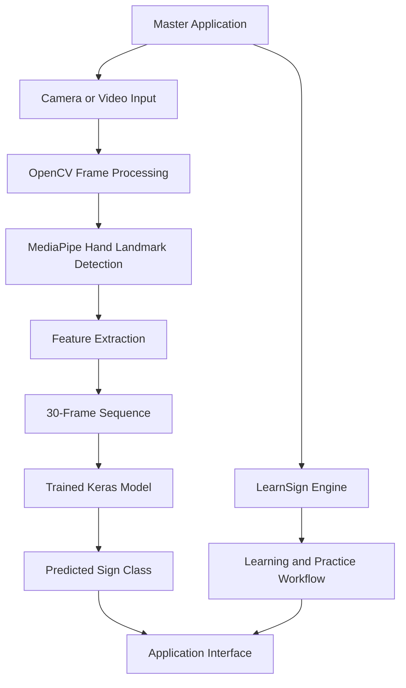

# 🎯 SignVerse AI — Sign Language Recognition & Learning Platform

An AI-powered sign language recognition and learning platform designed to recognize hand signs using deep learning and provide interactive sign-learning features.

---

## 📑 Table of Contents

- [Overview](#-overview)
- [Key Features](#-key-features)
- [Project Modules](#-project-modules)
- [System Architecture](#-system-architecture)
- [Technology Stack](#-technology-stack)
- [Deep Learning Model](#-deep-learning-model)
- [Project Structure](#-project-structure)
- [Prerequisites](#-prerequisites)
- [Installation](#-installation)
- [Dataset and Model Setup](#-dataset-and-model-setup)
- [How to Run](#-how-to-run)
- [How to Use](#-how-to-use)
- [Implementation Workflow](#-implementation-workflow)
- [Limitations](#-limitations)
- [Future Enhancements](#-future-enhancements)
- [Contributing](#-contributing)
- [License](#-license)
- [Acknowledgements](#-acknowledgements)

---

<table border="0" cellspacing="0" cellpadding="0" width="100%">
<tr>
<td width="75%" style="border: none; padding: 0;">

<h2 id="-overview">📌 Overview</h2>

</td>
<td width="25%" align="right" valign="middle" style="border: none; padding: 0; white-space: nowrap;">

<a href="#-table-of-contents">↑ Back to Contents</a>

</td>
</tr>
</table>

**SignVerse AI** is a sign language recognition and learning platform that combines computer vision and deep learning to support sign recognition and interactive learning.

The project extracts hand landmarks from video frames, converts them into numerical feature vectors, and uses a trained deep learning model to predict signs from temporal sequences.

The platform is organized into two main modules:

- **Module 1 — Communication Engine:** Supports sign recognition through the trained model.
- **Module 2 — LearnSign Engine:** Provides sign-learning and practice functionality.

The project is built using Python and integrates tools such as MediaPipe, OpenCV, TensorFlow/Keras, and CustomTkinter.

---

<table border="0" cellspacing="0" cellpadding="0" width="100%">
<tr>
<td width="75%" style="border: none; padding: 0;">

<h2 id="-key-features">✨ Key Features</h2>

</td>
<td width="25%" align="right" valign="middle" style="border: none; padding: 0; white-space: nowrap;">

<a href="#-table-of-contents">↑ Back to Contents</a>

</td>
</tr>
</table>

- 🎥 **Video and Camera Processing:** Processes visual input for sign recognition.
- ✋ **Hand Landmark Detection:** Uses MediaPipe to extract hand landmarks.
- 🧠 **Deep Learning-Based Recognition:** Uses a trained Keras model for sign classification.
- 🔢 **Feature Extraction:** Converts detected hand landmarks into numerical feature vectors.
- ⏱️ **Temporal Sequence Processing:** Uses a sequence of 30 frames as model input.
- 💬 **Communication Module:** Provides a recognition workflow through the application.
- 📚 **Learning Module:** Supports interactive sign-learning and practice features.
- 🖥️ **Desktop Interface:** Provides a graphical interface through CustomTkinter.
- 🧪 **Model Training Notebook:** Includes a Jupyter Notebook for the WLASL-300 deep learning workflow.

---

<table border="0" cellspacing="0" cellpadding="0" width="100%">
<tr>
<td width="75%" style="border: none; padding: 0;">

<h2 id="-project-modules">🧩 Project Modules</h2>

</td>
<td width="25%" align="right" valign="middle" style="border: none; padding: 0; white-space: nowrap;">

<a href="#-table-of-contents">↑ Back to Contents</a>

</td>
</tr>
</table>

### 1. Communication Engine

The Communication Engine is implemented in `module1_engine.py`.

Its primary purpose is to process visual input, extract hand landmarks, and use the trained model to predict signs.

**Main workflow:**

1. Capture or receive visual input.
2. Detect hand landmarks.
3. Extract numerical features.
4. Prepare a sequence of frames.
5. Pass the sequence to the trained model.
6. Obtain the predicted sign class.
7. Display the recognition result through the application.

### 2. LearnSign Engine

The LearnSign Engine is implemented in `module2_engine.py`.

It provides learning and practice functionality intended to help users interact with the sign-learning workflow.

The accuracy of practice feedback depends on how the selected sign, reference data, and comparison logic are implemented.

### 3. Master Application

`SignVerse_Master_App.py` serves as the main application entry point. It brings together the available project modules through the graphical interface.

---

<table border="0" cellspacing="0" cellpadding="0" width="100%">
<tr>
<td width="75%" style="border: none; padding: 0;">

<h2 id="-system-architecture">🏗️ System Architecture</h2>

</td>
<td width="25%" align="right" valign="middle" style="border: none; padding: 0; white-space: nowrap;">

<a href="#-table-of-contents">↑ Back to Contents</a>

</td>
</tr>
</table>

The high-level recognition workflow is illustrated below.



### Architecture Components

| Component | Responsibility |
|---|---|
| OpenCV | Camera and video frame processing |
| MediaPipe | Hand landmark detection |
| Feature extraction | Converts landmarks into numerical features |
| Keras model | Predicts the sign class |
| Communication Engine | Handles the recognition workflow |
| LearnSign Engine | Handles learning and practice functionality |
| Master Application | Integrates the available modules |

---

<table border="0" cellspacing="0" cellpadding="0" width="100%">
<tr>
<td width="75%" style="border: none; padding: 0;">

<h2 id="-technology-stack">🛠️ Technology Stack</h2>

</td>
<td width="25%" align="right" valign="middle" style="border: none; padding: 0; white-space: nowrap;">

<a href="#-table-of-contents">↑ Back to Contents</a>

</td>
</tr>
</table>

| Technology | Purpose |
|---|---|
| Python | Main programming language |
| TensorFlow / Keras | Deep learning model loading and inference |
| MediaPipe | Hand landmark detection |
| OpenCV | Video and camera processing |
| NumPy | Numerical operations and feature arrays |
| CustomTkinter | Desktop graphical user interface |
| Jupyter Notebook | Model development and experimentation |
| Git and GitHub | Version control and project hosting |

The actual dependencies required to run the application are specified in `requirements.txt`.

---

<table border="0" cellspacing="0" cellpadding="0" width="100%">
<tr>
<td width="75%" style="border: none; padding: 0;">

<h2 id="-deep-learning-model">🧠 Deep Learning Model</h2>

</td>
<td width="25%" align="right" valign="middle" style="border: none; padding: 0; white-space: nowrap;">

<a href="#-table-of-contents">↑ Back to Contents</a>

</td>
</tr>
</table>

The project uses a trained Keras model for sign classification.

### Model Configuration

| Parameter | Value |
|---|---|
| Sequence length | 30 frames |
| Features per frame | 126 |
| Number of output classes | 300 |
| Model input shape | `(batch_size, 30, 126)` |
| Saved model | `best_signverse_model_300.keras` |
| Training notebook | `SignVerse_Module1_WLASL300_DeepLearning.ipynb` |

### Feature Representation

The expected 126 features per frame are based on the following representation:

- 21 landmarks per hand.
- 3 coordinates per landmark: X, Y, and Z.
- 2 hands.

Therefore:

\[
21 \times 3 \times 2 = 126
\]

A sequence of 30 frames produces the input shape:

\[
30 \times 126
\]

The model processes this temporal sequence to predict one of its supported classes.

**Note:** The model's class predictions are limited to the vocabulary represented in its training data and label mapping. The number of classes alone does not establish the model's recognition accuracy.

---

<table border="0" cellspacing="0" cellpadding="0" width="100%">
<tr>
<td width="75%" style="border: none; padding: 0;">

<h2 id="-project-structure">📂 Project Structure</h2>

</td>
<td width="25%" align="right" valign="middle" style="border: none; padding: 0; white-space: nowrap;">

<a href="#-table-of-contents">↑ Back to Contents</a>

</td>
</tr>
</table>

Organize the repository approximately as follows. Keep the folder names consistent with the paths used in your Python code.

```text
SignVerse-AI/
│
├── SignVerse_Master_App.py
├── module1_engine.py
├── module2_engine.py
├── requirements.txt
├── README.md
│
├── SignVerse_Module1_WLASL300_DeepLearning.ipynb
│
├── saved_models/
│   └── best_signverse_model_300.keras
│
├── preprocessed_data_300/
│   └── label_map_300.json
│
└── DATASET_WLASL/
    ├── WLASL_v0.3.json
    └── videos/
```

**Important:** The dataset, label map, and model must actually exist at the expected locations for the corresponding functionality to work. If your repository uses different folder names, update this structure and the paths in the code accordingly.

---

<table border="0" cellspacing="0" cellpadding="0" width="100%">
<tr>
<td width="75%" style="border: none; padding: 0;">

<h2 id="-prerequisites">💻 Prerequisites</h2>

</td>
<td width="25%" align="right" valign="middle" style="border: none; padding: 0; white-space: nowrap;">

<a href="#-table-of-contents">↑ Back to Contents</a>

</td>
</tr>
</table>

Before installing the project, make sure you have:

- Python 3 installed.
- Git installed.
- A working webcam if you want to use live camera features.
- The required Python packages.
- The trained model and label mapping.
- The necessary dataset files for any functionality that depends on the original dataset.

Check your Python and Git installations:

```bash
python --version
git --version
```

---

<table border="0" cellspacing="0" cellpadding="0" width="100%">
<tr>
<td width="75%" style="border: none; padding: 0;">

<h2 id="-installation">⚙️ Installation</h2>

</td>
<td width="25%" align="right" valign="middle" style="border: none; padding: 0; white-space: nowrap;">

<a href="#-table-of-contents">↑ Back to Contents</a>

</td>
</tr>
</table>

### Step 1: Clone the Repository

Replace the example URL with your actual GitHub repository URL.

```bash
git clone https://github.com/YOUR_USERNAME/SignVerse-AI.git
cd SignVerse-AI
```

### Step 2: Create a Virtual Environment

**Windows:**

```bash
python -m venv venv
venv\Scripts\activate
```

**Linux / macOS:**

```bash
python3 -m venv venv
source venv/bin/activate
```

### Step 3: Install Dependencies

```bash
python -m pip install --upgrade pip
pip install -r requirements.txt
```

If installation fails, check the Python version and the compatibility of the packages listed in `requirements.txt`.

---

<table border="0" cellspacing="0" cellpadding="0" width="100%">
<tr>
<td width="75%" style="border: none; padding: 0;">

<h2 id="-dataset-and-model-setup">📦 Dataset and Model Setup</h2>

</td>
<td width="25%" align="right" valign="middle" style="border: none; padding: 0; white-space: nowrap;">

<a href="#-table-of-contents">↑ Back to Contents</a>

</td>
</tr>
</table>

The project uses a trained model and may require additional dataset and label-mapping files.

### Required Resources

| Resource | Purpose |
|---|---|
| `best_signverse_model_300.keras` | Trained sign classification model |
| `label_map_300.json` | Maps class identifiers to sign labels |
| `WLASL_v0.3.json` | Dataset metadata, if required by the implementation |
| `videos/` | Dataset video files, if required by the implementation |

### Setup Instructions

1. Place the trained model inside `saved_models/`.
2. Place the label mapping inside `preprocessed_data_300/`.
3. Place the dataset metadata and videos in the locations expected by the code if you need dataset-dependent functionality.
4. Verify that the file paths in the Python scripts match the actual folder structure.
5. Check the dataset's terms of use before redistributing its videos or metadata.

Large datasets and model files may be better distributed through a separate download link or Git Large File Storage (Git LFS), depending on their size and redistribution permissions.

**Troubleshooting:** If the application opens but recognition is unavailable, check whether the model and label-map paths are correct and whether the files have been included or downloaded.

---

<table border="0" cellspacing="0" cellpadding="0" width="100%">
<tr>
<td width="75%" style="border: none; padding: 0;">

<h2 id="-how-to-run">▶️ How to Run</h2>

</td>
<td width="25%" align="right" valign="middle" style="border: none; padding: 0; white-space: nowrap;">

<a href="#-table-of-contents">↑ Back to Contents</a>

</td>
</tr>
</table>

From the root directory of the project, activate your virtual environment and run:

```bash
python SignVerse_Master_App.py
```

This launches the master application if the dependencies and required resources are configured correctly.

### Run the Training Notebook

To explore the training workflow:

```bash
jupyter notebook SignVerse_Module1_WLASL300_DeepLearning.ipynb
```

You can also open the notebook in JupyterLab or Visual Studio Code.

**Note:** Running the notebook may require downloading the dataset and preparing the expected input files. Training from scratch is separate from running the application with the saved model.

---

<table border="0" cellspacing="0" cellpadding="0" width="100%">
<tr>
<td width="75%" style="border: none; padding: 0;">

<h2 id="-how-to-use">🧭 How to Use</h2>

</td>
<td width="25%" align="right" valign="middle" style="border: none; padding: 0; white-space: nowrap;">

<a href="#-table-of-contents">↑ Back to Contents</a>

</td>
</tr>
</table>

### Communication Engine

1. Launch the master application.
2. Open the communication or recognition module.
3. Provide the required camera or video input.
4. Allow the application to process the frames.
5. Review the predicted sign output.

### LearnSign Engine

1. Open the learning module.
2. Select an available learning or practice activity.
3. Follow the instructions displayed by the application.
4. Review the practice feedback provided by the implemented comparison logic.

The exact screens and controls depend on the functionality implemented in the current version of the application.

---

<table border="0" cellspacing="0" cellpadding="0" width="100%">
<tr>
<td width="75%" style="border: none; padding: 0;">

<h2 id="-implementation-workflow">🔄 Implementation Workflow</h2>

</td>
<td width="25%" align="right" valign="middle" style="border: none; padding: 0; white-space: nowrap;">

<a href="#-table-of-contents">↑ Back to Contents</a>

</td>
</tr>
</table>

The overall workflow consists of the following stages:

1. **Input collection:** Acquire video frames from a camera or video source.
2. **Frame processing:** Process the frames using OpenCV.
3. **Landmark detection:** Detect hand landmarks using MediaPipe.
4. **Feature preparation:** Represent the landmarks as numerical feature vectors.
5. **Sequence preparation:** Construct the expected 30-frame input sequence.
6. **Model inference:** Pass the sequence to the trained Keras model.
7. **Classification:** Obtain the predicted class and map it to a label.
8. **Result presentation:** Display the recognition result in the user interface.
9. **Learning and practice:** Use the learning module's implemented features to support sign practice.

---

<table border="0" cellspacing="0" cellpadding="0" width="100%">
<tr>
<td width="75%" style="border: none; padding: 0;">

<h2 id="-limitations">⚠️ Limitations</h2>

</td>
<td width="25%" align="right" valign="middle" style="border: none; padding: 0; white-space: nowrap;">

<a href="#-table-of-contents">↑ Back to Contents</a>

</td>
</tr>
</table>

- **Limited vocabulary:** Recognition is restricted to the classes supported by the trained model.
- **Input conditions:** Performance can vary with lighting, camera quality, hand visibility, and signing speed.
- **Dataset dependence:** Recognition performance depends on the training data and how well it represents real-world signing.
- **Continuous signing:** Recognizing isolated signs does not automatically provide complete sentence-level sign language translation.
- **Practice feedback:** The usefulness of practice scores depends on the validity of the reference data and comparison method.
- **Hardware dependence:** Inference speed varies according to the device and execution environment.
- **Sign language variation:** Sign languages differ by region and community; a model trained on a particular vocabulary should not be treated as universal.
- **Model evaluation:** Accuracy and inference speed should be measured using a documented evaluation procedure before being reported as verified results.

SignVerse AI is a learning and development project, not a replacement for qualified sign language interpreters.

---

<table border="0" cellspacing="0" cellpadding="0" width="100%">
<tr>
<td width="75%" style="border: none; padding: 0;">

<h2 id="-future-enhancements">🚀 Future Enhancements</h2>

</td>
<td width="25%" align="right" valign="middle" style="border: none; padding: 0; white-space: nowrap;">

<a href="#-table-of-contents">↑ Back to Contents</a>

</td>
</tr>
</table>

Potential improvements include:

- Expanding the supported sign vocabulary.
- Improving recognition under different lighting and camera conditions.
- Adding continuous sign recognition and sentence-level processing.
- Improving the reference-based practice scoring mechanism.
- Enhancing the user interface and recognition feedback.
- Adding a more realistic and expressive 3D signing avatar.
- Evaluating the model using independent test data.
- Improving dependency management and deployment.
- Adding automated tests for model loading, feature extraction, and application workflows.

---

<table border="0" cellspacing="0" cellpadding="0" width="100%">
<tr>
<td width="75%" style="border: none; padding: 0;">

<h2 id="-contributing">🤝 Contributing</h2>

</td>
<td width="25%" align="right" valign="middle" style="border: none; padding: 0; white-space: nowrap;">

<a href="#-table-of-contents">↑ Back to Contents</a>

</td>
</tr>
</table>

Contributions and suggestions are welcome.

To contribute:

1. Fork the repository.
2. Create a new branch.
3. Make your changes.
4. Test the changes locally.
5. Commit your work with a descriptive message.
6. Open a pull request explaining the changes.

Example:

```bash
git checkout -b feature/your-feature
git add .
git commit -m "add your feature"
git push origin feature/your-feature
```

Please avoid committing passwords, personal information, virtual environments, caches, or large files that should be distributed separately.

---

<table border="0" cellspacing="0" cellpadding="0" width="100%">
<tr>
<td width="75%" style="border: none; padding: 0;">

<h2 id="-license">📄 License</h2>

</td>
<td width="25%" align="right" valign="middle" style="border: none; padding: 0; white-space: nowrap;">

<a href="#-table-of-contents">↑ Back to Contents</a>

</td>
</tr>
</table>

Choose and add an appropriate open-source license before distributing the project. If you use third-party datasets, libraries, or pretrained resources, follow their respective licenses and usage conditions.

---

<table border="0" cellspacing="0" cellpadding="0" width="100%">
<tr>
<td width="75%" style="border: none; padding: 0;">

<h2 id="-acknowledgements">🙏 Acknowledgements</h2>

</td>
<td width="25%" align="right" valign="middle" style="border: none; padding: 0; white-space: nowrap;">

<a href="#-table-of-contents">↑ Back to Contents</a>

</td>
</tr>
</table>

- The MediaPipe team for hand landmark detection tools.
- The TensorFlow and Keras communities for deep learning tools.
- The OpenCV community for computer vision utilities.
- The WLASL dataset authors and contributors, subject to the dataset's applicable terms of use.
- The open-source community for the libraries and tools used in this project.

---

<div align="center">

**Built with Python, Computer Vision, and Deep Learning.**

</div>
